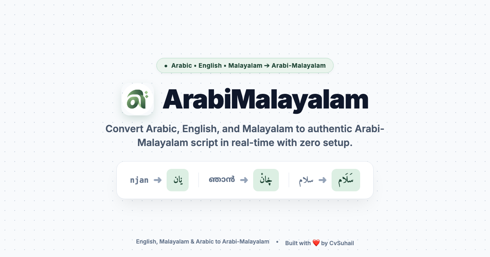

<div align="center">

  

# ArabiMalayalam (അറബി-മലയാളം)

**Intelligent, real-time Arabi-Malayalam transliterator, phonetic keyboard & document editor.**

[](https://arabi-malayalam.cvsuhail.online/)
[](https://www.buymeacoffee.com/suhailcv)
[](https://www.typescriptlang.org/)
[](https://react.dev/)
[](https://vitejs.dev/)
[](https://dexie.org/)
[](LICENSE)
[](https://www.cvsuhail.online/)

  <br />

  <p align="center">
    <a href="https://arabi-malayalam.cvsuhail.online/"><strong>Live Web App</strong></a> •
    <a href="#-key-features"><strong>Key Features</strong></a> •
    <a href="#-arabi-malayalam-script-matrix"><strong>Script Matrix</strong></a> •
    <a href="#-pwa-mobile-experience"><strong>PWA Install</strong></a> •
    <a href="#-getting-started"><strong>Quick Start</strong></a> •
    <a href="#-author--credits"><strong>Author</strong></a>
  </p>

  

</div>

---

## 📖 Overview

**ArabiMalayalam** is a modern, high-performance web and mobile application designed to preserve and revitalize **Arabi-Malayalam** (അറബി-മലയാളം / اَرَبِ مَلَيَاۻَمْ) — the traditional writing system of the Mappila community in Malabar, Kerala.

It enables effortless typing and real-time transliteration from **English (Manglish)**, **Malayalam Unicode**, and **Standard Arabic** into authentic Arabi-Malayalam script, featuring classical font rendering, vowel diacritics, and offline Progressive Web App (PWA) functionality.

---

## ✨ Key Features

- **⚡ Multi-Source Real-Time Transliteration**:
  - **English (Manglish) ➔ Arabi-Malayalam**: Type naturally using English letters (e.g., `njan` ➔ `ڿَانْ`, `keralam` ➔ `ك٘يڔَۻَمْ`, `onnu` ➔ `اٗنّْ`).
  - **Malayalam ➔ Arabi-Malayalam**: Directly paste or type Malayalam Unicode (e.g., `ഞാൻ` ➔ `ڿَانْ`, `വെള്ളം` ➔ `و٘ۻَّمْ`).
  - **Arabic loanwords** keep their Arabic spelling: `salam` ➔ `سَلَام`, `swalath` ➔ `صَلَاة`, `bismillah` ➔ `بِسْمِ اللّٰه`.
  - **Arabic input** is kept as typed, with fully vocalized spellings offered for common words.
- **🎯 Floating Suggestion Dropdown**:
  - Appears right below the active word being typed with numbered candidate suggestions, each with its Malayalam reading.
  - Ranked by a 30,000-word Malayalam frequency list, so the real word comes first even from casual spellings (`kandu` ➔ കണ്ടു, `pattum` ➔ പറ്റും, `sukhamano` ➔ സുഖമാണോ).
  - Whole-word completions while typing (`sukh` ➔ സുഖം, സുഖമാണോ).
  - Up to nine suggestions per word, so the word you meant is there even when a spelling fits several words (`padam` ➔ പടം, പാടം, പദം, പാഠം).
  - Quick selection using number keys (`1`–`9`, `0` for the tenth row), `Spacebar`, or any punctuation; works with phone keyboards too.
  - Learns the words and the o-mark style you pick.
  - Verbatim fallback candidate ensures custom spellings are never lost.
- **🔤 Comprehensive Phonetic Alphabet Support**:
  - Implements the standard Arabi-Malayalam letters (`ڿ`, `ۼ`, `ڊ`, `ڗ`, `ڹ`, `ۻ`, `ژ`, `ۺ`, `ڔ`, `پ`, `چ`, `گ`, `ق`, `ھ`) and aspirates with `ھ`.
  - Full harakat on every letter, including long ā as fatha + alef: `kaanaan` ➔ `كَاڹَانْ`.
  - Distinct short-vowel marks for **'e' (٘)** and **'o' (ٗ)** alongside standard harakat (`َ`, `ِ`, `ُ`, `ْ`, `ّ`).
- **📱 Native-Quality Progressive Web App (PWA)**:
  - Installable on mobile devices (iOS Safari and Android Chrome).
  - Native iOS-style bottom sheet installation prompt on initial launch.
  - Zero-scroll sticky formatting toolbar tailored specifically for mobile touchscreens.
- **💾 Local-First & 100% Private**:
  - Automatic background saving powered by browser **IndexedDB**.
  - All transliteration executes client-side; zero data sent to external servers.
- **🎨 Classical Typography & Fonts**:
  - Preview your writing in authentic calligraphy and typefaces: _Amiri_, _Noto Naskh Arabic_, _Scheherazade New_, _Lateef (Nastaliq)_, _Aref Ruqaa_, _Noto Sans Arabic_, _Harmattan_, and _Reem Kufi_.
- **🎙️ Speech-to-Text Voice Typing**:
  - Built-in microphone dictation for fast hands-free writing.
- **📤 Export & Sharing**:
  - Download formatted `.txt` files with clean slugified filenames or instant one-click clipboard copy.

---

## 🔠 Arabi-Malayalam Script Matrix

Arabi-Malayalam adapts the Arabic alphabet to represent Dravidian Malayalam phonetic sounds that do not exist in standard Arabic:

Letter choices follow the standard Arabi-Malayalam table (see the
[Wikipedia article](https://en.wikipedia.org/wiki/Arabi_Malayalam_script)). Where
sources differ, the keyboard uses ھ for ഹ, ق for ഖ and the dotted yeh ي, and
marks long ā with fatha + alef. Native സ്വ is written سْو; ص is kept for Arabic
loanwords such as സ്വലാത്ത് (صَلَاة).

| Malayalam Letter | Arabi-Malayalam Glyph | Unicode Code | Name / Phonetic Sound                        | Example Transliteration      |
| :--------------: | :-------------------: | :----------: | :------------------------------------------- | :--------------------------- |
|      **ഞ**       |         **ڿ**         |   `U+06BF`   | Arabic letter Tcheh with dot above (`nja`)   | _njan_ ➔ `ڿَانْ`             |
|      **ങ**       |         **ۼ**         |   `U+06FC`   | Arabic letter Ghain with dot below (`nga`)   | _thenga_ ➔ `ت٘يۼَّ`          |
|      **ഗ**       |         **گ**         |   `U+06AF`   | Arabic letter Gaf (`ga`)                     | _gaanam_ ➔ `گَانَمْ`         |
|      **ര**       |         **ڔ**         |   `U+0694`   | Arabic letter Reh with dot below (`ra`)      | _keralam_ ➔ `ك٘يڔَۻَمْ`      |
|      **റ**       |         **ر**         |   `U+0631`   | Arabic letter Reh (`rra`)                    | _paranju_ ➔ `پَرَڿُّ`        |
|      **ള**       |         **ۻ**         |   `U+06FB`   | Arabic letter Dad with dot below (`lla`)     | _vellam_ ➔ `و٘ۻَّمْ`         |
|      **ണ**       |         **ڹ**         |   `U+06B9`   | Arabic letter Noon with dot below (`Nna`)    | _kannu_ ➔ `كَڹّْ`            |
|      **ഴ**       |         **ژ**         |   `U+0698`   | Arabic letter Jeh (`zha`)                    | _mazha_ ➔ `مَژَ`             |
|      **ട**       |         **ڊ**         |   `U+068A`   | Arabic letter Dal with dot below (`Tta`)     | _veedu_ ➔ `وِيڊْ`            |
|      **ഡ**       |         **ڗ**         |   `U+0697`   | Arabic letter Reh with two dots above (`Da`) | _doctor_ ➔ `ڗٗوكْڊَرْ`       |
|      **ഷ**       |         **ۺ**         |   `U+06FA`   | Arabic letter Sheen with dot below (`sha`)   | _santhosham_ ➔ `سَنْتٗوۺَمْ` |
|      **പ**       |         **پ**         |   `U+067E`   | Arabic letter Peh (`pa`)                     | _poyi_ ➔ `پٗويِ`             |
|      **ച**       |         **چ**         |   `U+0686`   | Arabic letter Tcheh (`cha`)                  | _cheythu_ ➔ `چ٘يْتُ`         |
|      **ഹ**       |         **ھ**         |   `U+06BE`   | Arabic letter Heh Doachashmee (`ha`)         | _hello_ ➔ `ھَلٗو`            |
|      **ഖ**       |         **ق**         |   `U+0642`   | Arabic letter Qaf (`kha`)                    | _sukham_ ➔ `سُقَمْ`          |
|      **യ**       |         **ي**         |   `U+064A`   | Arabic letter Yeh, dotted (`ya`)             | _poyi_ ➔ `پٗويِ`             |

Aspirated consonants add `ھ` (`U+06BE`) to the base letter, so they never collide
with doubled letters: ഥ ➔ `تَھ` but ത്ത ➔ `تَّ`; ഭ ➔ `بَھ`; ധ ➔ `دَھ`.

### Special Vowel Marks

|      Sound      | Diacritic |     Unicode     | Usage                                                                                           |
| :-------------: | :-------: | :-------------: | :---------------------------------------------------------------------------------------------- |
| **എ (Short e)** |    `٘`    |    `U+0658`     | Small inverted mark below letter to represent short Dravidian 'e'                               |
| **ഒ (Short o)** |    `ٗ`    |    `U+0657`     | Inverted damma mark above letter to represent short Dravidian 'o' (plain damma `ُ` offered too) |
| **ആ (Long a)**  |   `َا`    | `U+064E U+0627` | Fatha + alef after a consonant (`كَا`); `آ` (`U+0622`) at the start of a word                   |

---

## 📱 PWA & Mobile Experience

ArabiMalayalam is engineered as a standalone Progressive Web App:

- **iOS (iPhone/iPad)**:
  1. Open [arabi-malayalam.cvsuhail.online](https://arabi-malayalam.cvsuhail.online/) in **Safari**.
  2. Tap the **Share** button ($\uparrow$) at the bottom of Safari.
  3. Scroll down and tap **Add to Home Screen**.
- **Android**:
  1. Open in **Google Chrome**.
  2. Tap **Install ArabiMalayalam** on the bottom sheet prompt or from the browser menu.
- **Offline Access**:
  - Service Worker (`sw.js`) caches static assets, web fonts, and application bundles so the editor remains fully accessible without internet.

---

## 🛠️ Tech Stack & Architecture

- **Framework**: [TanStack Start](https://tanstack.com/start/latest) with [TanStack Router](https://tanstack.com/router)
- **UI Library**: [React 19](https://react.dev/)
- **Bundler & Build Tool**: [Vite 8](https://vitejs.dev/) with [Rolldown](https://rolldown.rs/)
- **Styling**: [Tailwind CSS](https://tailwindcss.com/) with custom font definitions
- **Storage**: [Dexie.js](https://dexie.org/) (Client-side IndexedDB wrapper)
- **Transliteration engine** (`src/lib/transliteration/`, all client-side):
  - `manglishPhonetic.ts`: Manglish ➔ Malayalam spelling generator with weighted, context-aware readings (`nd` ➔ ണ്ട, intervocalic `ch` ➔ ച്ച, final `n` ➔ ൻ, final `u` ➔ ് or ു, …)
  - `malayalamLexicon.ts`: 30,000-word Malayalam frequency list that picks real words and offers completions
  - `malayalamToArabic.ts`: deterministic Malayalam ➔ Arabi-Malayalam rule engine
  - `arabicLoanwords.ts`: Arabic-origin words written in their Arabic spelling
  - `smartManglishLayer.ts`: ranking, learning, paste and dictation conversion
- **Icons**: [Lucide React](https://lucide.dev/)
- **Notifications**: [Sonner](https://sonner.emilkowal.ski/)

### Smart Manglish ranking

Roman input becomes ranked **Malayalam** candidates first, and only then
Arabi-Malayalam, so every suggestion shares one orthography. Candidates come
from user selections, curated spelling overrides, registered Roman↔Malayalam
corpus rows, an optional model provider, and the phonetic generator. The
generator searches many spellings, keeps those that are prefixes of real words,
and the frequency list ranks them. Large datasets should remain in a backend
index rather than being bundled into the browser.

### Word list

`public/lexicon/ml-words.txt` is fetched lazily (about 170 KB gzipped) and
cached by the service worker. It is built from the
[FrequencyWords](https://github.com/hermitdave/FrequencyWords) Malayalam list
(OpenSubtitles 2018), licensed **CC-BY-SA-4.0**; the derived file carries the
same licence. To rebuild it:

```bash
curl -L -o ml_50k.txt https://raw.githubusercontent.com/hermitdave/FrequencyWords/master/content/2018/ml/ml_50k.txt
node scripts/build-lexicon.mjs ml_50k.txt
```

Kerala and Mappila vocabulary that subtitles rarely contain (place names,
kinship terms, religious and cultural words) is added in
`enhancedTransliterator.ts`.

Set `VITE_MALAYALAM_TRANSLITERATION_ENDPOINT` to enable the optional provider.
The endpoint receives a `POST` body containing `text`, `language`, `limit`, and
the previous-word `context`, and returns Malayalam candidates:

```json
{
  "candidates": [{ "text": "സുഖമാണോ", "score": 1 }]
}
```

Without this environment variable, the keyboard continues to use its local
overrides, word list, user learning, and phonetic generator.

---

## 🚀 Getting Started

### Prerequisites

- [Node.js](https://nodejs.org/) (version 18+ recommended)
- `npm` or `pnpm` / `bun`

### Installation

1. **Clone the repository**:

   ```bash
   git clone https://github.com/CvSuhail/arabiMalayalamKeyboard.git
   cd arabiMalayalamKeyboard
   ```

2. **Install dependencies**:

   ```bash
   npm install
   ```

3. **Start the development server**:

   ```bash
   npm run dev
   ```

   Open [http://localhost:8080](http://localhost:8080) in your browser.

4. **Build for production**:

   ```bash
   npm run build
   ```

5. **Preview production build**:
   ```bash
   npx vite preview
   ```

---

## 🌐 SEO, GEO & AIO Optimization

ArabiMalayalam includes enterprise-grade optimizations for traditional search engines (Google, Bing) and AI Answer Engines (Perplexity, ChatGPT Search, Claude, Google Gemini):

- **Structured Data (JSON-LD)**:
  - `WebApplication` schema with full feature list and system specifications.
  - `WebSite` schema describing the canonical keyboard website.
  - `Person` author schema linking directly to creator profiles.
- **`llms.txt` Standard**:
  - Implements the modern `/llms.txt` standard for AI web crawlers (GPTBot, ClaudeBot, PerplexityBot) with full phonetic alphabet specifications and orthography guides.
- **Open Graph & Twitter Cards**:
  - Rich 1200×630 social preview cards (`/og-image.png`).
- **Sitemap & Robots**:
  - Canonical-domain `sitemap.xml` and crawl directives in `robots.txt`.

### Google Tag Manager

Set `VITE_GTM_ID` to your Tag Manager container ID (for example, `GTM-XXXXXXX`) in the production deployment environment. The app then renders the official loader high in `<head>` and the `<noscript>` fallback immediately after `<body>`. Invalid or missing IDs are ignored, so placeholder analytics are never sent.

---

## 💬 Feedback & Contributions

Contributions, bug reports, and script suggestions are warmly welcome!

- **WhatsApp Direct**: Have suggestions or found a transliteration edge case? [Message on WhatsApp (+91 95627 70397)](https://wa.me/919562770397?text=Hi%20ArabiMalayalam%20Team)
- **Submit Pull Requests**: Feel free to submit PRs for new font support, vocabulary enhancements, or UI improvements.

---

## 👨‍💻 Author & Credits

Designed and built with ❤️ by **CvSuhail**.

- **Portfolio**: [cvsuhail.online](https://www.cvsuhail.online/)
- **Contact**: [+91 95627 70397](https://wa.me/919562770397)
- **Support**: [](https://buymeacoffee.com/suhailcv) — [buymeacoffee.com/suhailcv](https://buymeacoffee.com/suhailcv)

---

## 📄 License

This project is licensed under the [MIT License](LICENSE).
